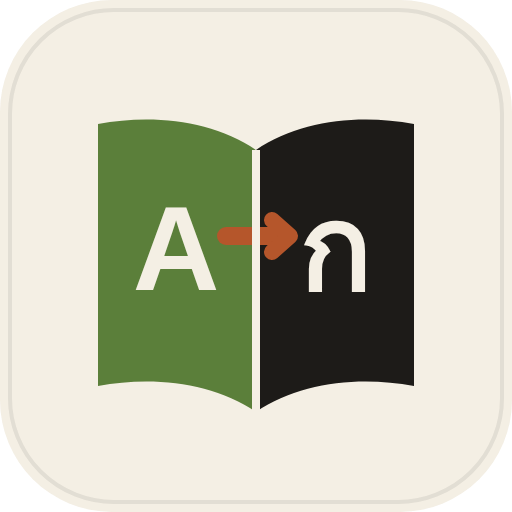
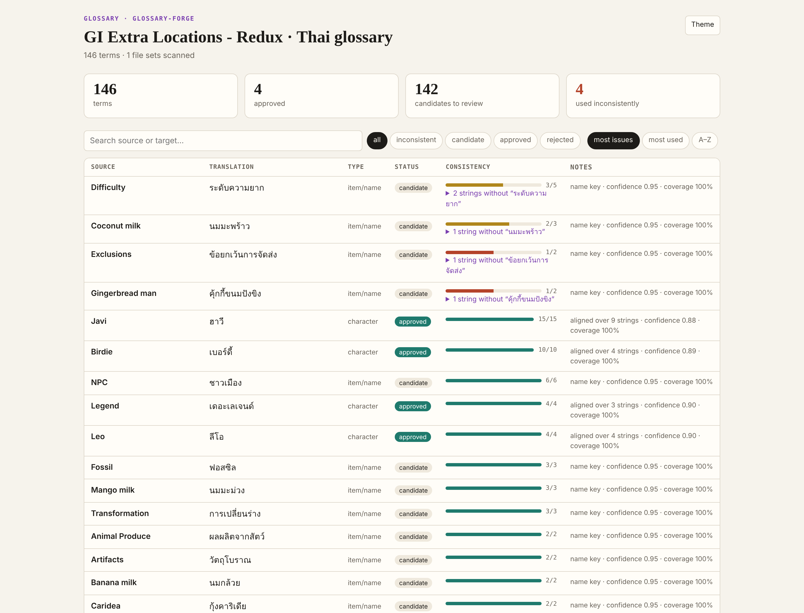
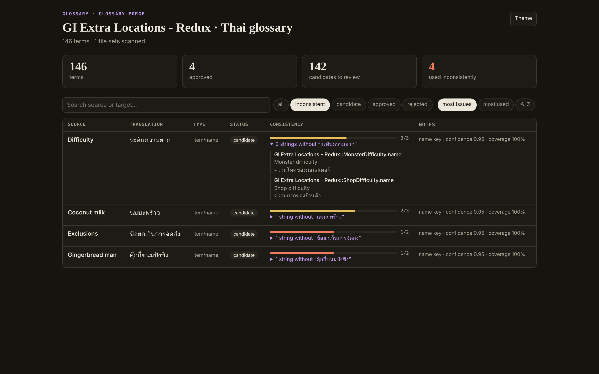
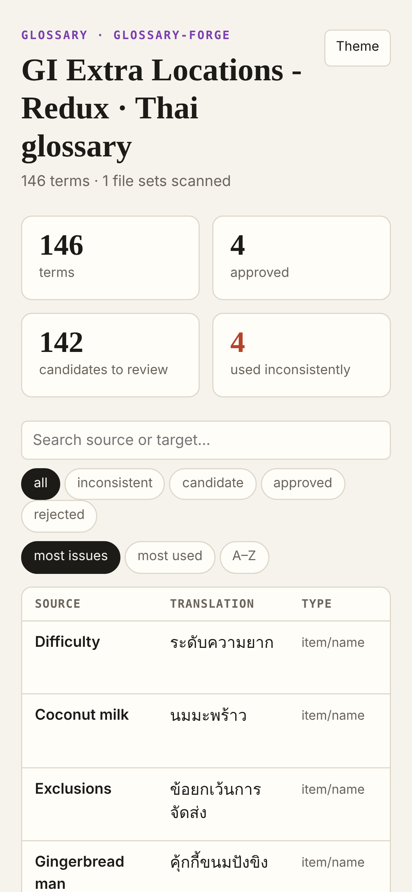

# Glossary Forge

Build a translation glossary from the translations you already have — and find every term translated two different ways.

A free, open-source [agent skill](https://www.agensi.io/learn/skill-md-format) (SKILL.md) for translators of game mods and apps. Works with Claude Code, Codex CLI, Cursor, Gemini CLI and any agent that supports the SKILL.md standard.

## Screenshots

| Glossary report: 146 terms mined, with consistency bars | Inconsistent terms (dark): the strings that break the pattern |
|---|---|
|  |  |
| **Mobile** | |
|  | |

*Real output, not a mock-up:* mined from the Thai translation of **GI Extra Locations - Redux** — 146 terms, and it found *Difficulty* translated as ระดับความยาก in three places but ความโหดของมอนสเตอร์ and ความยากของร้านค้า in two others. A smaller run on the synthetic test mod is in [`examples/moonlit-orchard/`](examples/moonlit-orchard/).

## What it does

- **Mines terms** from name keys (`item.name`, `npc.*`), "ไทย (English)" pairs and statistical alignment that works for languages without spaces (Thai, Japanese, Chinese).
- **Checks consistency:** for each term, how many strings use the approved translation — and shows the ones that don't.
- **Review page** (`l10n/glossary.html`): search, filter by status, sort by issues or usage.
- **Exports** CSV (used by the rest of the kit), TBX for CAT tools, or JSON.

## Use the script directly

```bash
python3 scripts/glossary.py mine                     # → l10n/glossary.csv (candidates)
python3 scripts/glossary.py report                   # → l10n/glossary.html
python3 scripts/glossary.py add "Javi" "ฮาวี" --type character
python3 scripts/glossary.py check --approved-only --strict   # CI gate
python3 scripts/glossary.py export --format tbx
```

## Part of the Localization Kit

Four agent skills that share one project file (`.l10n.json`) and one glossary (`l10n/glossary.csv`):

| Skill | | What it does |
|---|---|---|
|  [loc-translate](https://github.com/AppleBoiy/loc-translate) | free | Translates locale files without breaking tokens, comments or layout |
|  **glossary-forge** | free | Mines a glossary from existing translations and finds inconsistent terms |
| [loc-qa](https://www.agensi.io) | paid | Release check: broken tokens, structure, glossary, overflow, Thai particles — on one dashboard |
| [loc-sync](https://www.agensi.io) | paid | After the original updates: new, changed (stale) and removed strings, with word diffs |

Each skill also works on its own.

## Install

**Any agent through Agensi** — search for `glossary-forge` on [agensi.io](https://www.agensi.io) and add it (free).

**Claude Code**

```bash
git clone https://github.com/AppleBoiy/glossary-forge.git ~/.claude/skills/glossary-forge
```

**Other agents** (Codex CLI, Cursor, Gemini CLI…) — copy the folder into the agent's skills directory.

Needs only Python 3.10+ — no packages, no network access, no API keys.

## Works with

- **SMAPI / Stardew Valley** `i18n/*.json` and Content Patcher packs — JSONC with comments, trailing commas, BOM and CRLF all kept as they are.
- **App locale files** (`en.json` → `th.json`, nested or flat): `{name}`, `{0}`, `%@`, `%d`, HTML tags and entities.
- Any target language. Extra care for **Thai** (combining marks, ครับ/ค่ะ by speaker, decomposed sara am) and other unspaced scripts.

Settings live in `.l10n.json`, created automatically and shared by every skill in the kit — see [`references/project-files.md`](references/project-files.md).

## Privacy and network

Runs fully offline. Reads and writes only inside your project folder (`l10n/` for work files and reports). The HTML reports are single files that make no network requests.

## Tests

```bash
python3 -m unittest discover -s tests -v   # synthetic "Moonlit Orchard" mod + app fixtures
python3 tools/package.py                    # builds dist/<skill>.zip (single-file script for Agensi)
```

## Licence

[MIT](LICENSE)
